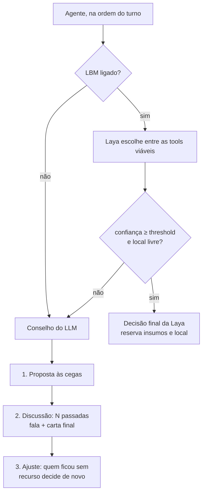

# Aldeia de Agentes

Jogo cooperativo em turnos em que agentes de IA vivem numa aldeia e precisam
chegar vivos ao fim da partida: coletar recursos, transformar insumos em comida,
curar feridos e combinar entre si quem faz o quê.

O motor é **determinístico** (mesma seed → mesmo mundo). Quem decide as ações é:

- **LBM (Laya)**: roteador rápido e barato, servido num container via HTTP.
- **LLM**: via [Strands Agents](https://strandsagents.com), com conselho de
  discussão entre os agentes.
- **bot**: determinístico, para testes e linha de base.

## Sumário

- [Início rápido](#início-rápido)
- [Como o jogo funciona](#como-o-jogo-funciona)
- [Como os agentes decidem](#como-os-agentes-decidem)
- [Configuração](#configuração)
- [Páginas do frontend](#páginas-do-frontend)
- [API](#api)
- [Estrutura do projeto](#estrutura-do-projeto)
- [Testes](#testes)

## Início rápido

Requisitos: Python 3.10+ (desenvolvido e testado no 3.14) e, para usar Laya/LLM
local, Docker.

```bash
python3 -m venv .venv
source .venv/bin/activate
pip install -r requirements.txt

cp .env.example .env        # preencha só a chave do provedor que for usar
python server.py            # http://127.0.0.1:8000/
```

O servidor escuta apenas em `127.0.0.1`.

### Serviços opcionais (Laya e LLM local)

```bash
cd laya
docker compose up -d        # Laya em :8001 e Ollama em :11434
docker exec -it ollama ollama pull llama3.2
```

Sem a Laya no ar, ela devolve confiança 0 e todo agente escala para o LLM.
Sem nenhum LLM, use o decisor `bot`.

### Hook de segurança (recomendado)

Bloqueia commit de `.env` e de chaves em texto (`gsk_`, `sk-ant-`, `sk-`, `AKIA`, `AIza`):

```bash
ln -sf ../../scripts/pre-commit .git/hooks/pre-commit
```

## Como o jogo funciona

Cada turno segue a mesma sequência:

1. **Basal**: cada agente vivo paga 1 de alimento (3 no inverno, os últimos 20%
   dos turnos). Quem não paga perde 1 vida; vida 0 é morte permanente.
2. **Eventos**: tempestade (sem pesca), fartura (coletas rendem mais), doença
   (1 ou 2 agentes perdem vida) e praga (perda de um recurso).
3. **Ordem do turno**: sorteio determinístico a partir da seed.
4. **Decisão**: cada agente escolhe uma ação (ver próxima seção).
5. **Execução**, na ordem canônica: curar → transformar → coletar → forragear → passar.
   Coletas e transformações passam pelo **MCP do mundo**, que sorteia o resultado.
6. **Persistência**: histórico do turno (decisões, movimentos, chamadas MCP,
   eventos de vida, placar) em `data/partida_{id}.json`.

### Recursos e ações

| Categoria | Ações | Observação |
|-----------|-------|------------|
| Coletar | `cacar`, `pescar`, `coletar_trigo`, `coletar_erva`, `coletar_madeira` | Custam alimento (3 a 12). Mais de 2 agentes no mesmo local saturam. |
| Transformar | `fazer_pao`, `assar_carne`, `assar_peixe`, `preparar_remedio` | Consomem insumos + 1 madeira. Podem falhar. |
| Curar | `curar` | Gasta 1 remédio, +1 vida no alvo. |
| Outras | `forragear` (grátis, 60% de +1 alimento), `passar` | |

Comida: peixe (4), carne (6), pão (18), peixe assado (22), carne assada (26).
Trigo, erva, madeira e remédio não são comida. Todo o balanceamento está em
`presets/padrao.json`.

### Pontuação

```
pontuação = vivos × 1000 + soma das vidas × 100 + valor do estoque
```

Classificação: Próspera (≥ 5000), Estável (≥ 3000), Sobrevivente (≥ 1500),
Em Risco (≥ 500) e Caída.

## Como os agentes decidem

A partida é criada com um decisor (`llm` ou `bot`). No `llm`, o toggle **LBM**
define se a Laya participa.



- **Ações viáveis**: o motor calcula o que cada agente pode fazer (custo,
  insumos, estação, clima, alvo de cura). Nenhum decisor recebe opção inválida.
- **Reservas**: quando um agente decide, os insumos, o alimento e o alvo de cura
  dele ficam reservados. O próximo da ordem já vê as opções descontadas, o que
  evita, por exemplo, dois agentes tentando o mesmo pão com trigo para um.
- **Laya**: recebe o estado do turno e as tools viáveis do agente, e devolve
  escolha + confiança. Se a confiança fica abaixo do `threshold` (padrão 0,5) ou
  o local da ação já tem 2 agentes, o agente escala para o conselho.
- **Conselho**: só os agentes escalados participam; as cartas da Laya aparecem
  travadas na mesa. Cada fala é uma única chamada ao LLM (mensagem + carta).
  Se ninguém troca de carta numa passada, há consenso e a discussão termina.
- **Agentes**: cada um tem prompt, skills (texto injetado no system prompt) e
  tools (as ações que pode usar), editáveis na tela do jogo.

## Configuração

Segredos ficam **só** no `.env`. O resto fica em JSONs editáveis pela página de
Configuração.

| Arquivo | Conteúdo | Versionado |
|---------|----------|------------|
| `.env` | `GROQ_API_KEY` (Groq e OpenAI-compatível), `ANTHROPIC_API_KEY` | não |
| `config_llm.json` | perfis de LLM e perfil ativo | não |
| `config_lbm.json` | URL e timeout da Laya, `threshold` | sim |
| `mcp_mundo_config.json` | probabilidades do MCP do mundo | sim |
| `presets/padrao.json` | balanceamento do jogo | sim |

O Bedrock usa as credenciais AWS do ambiente. Servidores em `localhost` (Ollama)
não precisam de chave.

### Perfis de LLM

`config_llm.json` guarda perfis nomeados. O seletor "Perfil do LLM" em
Configuração troca de provedor com um clique, valendo já na próxima decisão.

| Perfil | Provedor | Observação |
|--------|----------|------------|
| `groq` | Groq | precisa de `GROQ_API_KEY` |
| `local-llama` | Ollama (`llama3.2`) | local, sem chave |
| `local-minicpm` | Ollama (MiniCPM) | use `reasoning_effort: none` |
| `claude` | Anthropic | precisa de `ANTHROPIC_API_KEY` |

Em "Avançado", cada perfil ajusta timeout, máximo de tokens, `reasoning_effort`
e limite de tokens por minuto (útil contra erro 429 do Groq). "Novo perfil"
copia o atual. Num clone novo os perfis padrão são criados sozinhos.

## Páginas do frontend

| Página | Para quê |
|--------|----------|
| `jogo.html` | Criar partida, rodar turnos (manual ou automático), editar agentes, ver decisões por agente, conselho e chamadas MCP |
| `historia.html` | Narrativa da partida turno a turno e pontuação final |
| `analise.html` | Estoque, ganhos e perdas, vidas, eventos, conversas, divergência intenção × ação, exportação CSV, comparação entre partidas |
| `ranking.html` | Todas as partidas ordenadas por pontuação |
| `agentes.html` | Lista de agentes |
| `config.html` | Perfis de LLM, Laya e testes de conexão |

## API

<details>
<summary>Rotas (FastAPI, docs interativas em <code>/docs</code>)</summary>

| Método | Rota | Descrição |
|--------|------|-----------|
| GET | `/partidas` | Lista partidas |
| POST | `/partidas` | Cria partida (`decisor`, `lbm_habilitado`, `rodadas_conselho`, ...) |
| DELETE | `/partidas` | Apaga todas as partidas |
| GET | `/partidas/{id}` | Metadados |
| POST | `/partidas/{id}/iniciar` | Inicia |
| POST | `/partidas/{id}/turno` | Executa o próximo turno |
| POST | `/partidas/{id}/encerrar` | Encerra e calcula o placar |
| POST | `/partidas/{id}/retomar` | Destrava após falha (alias: `reset-lock`) |
| GET | `/partidas/{id}/estado` | Estado atual |
| GET/PUT | `/partidas/{id}/agentes/{aid}/prompt` | Prompt do agente |
| PUT | `/partidas/{id}/agentes/{aid}/config` | Prompt, skills e tools do agente |
| GET | `/partidas/{id}/analise/{tipo}` | JSON: `estoque`, `ganhos-perdas`, `vidas`, `eventos`, `conversas`, `decisoes` |
| GET | `/partidas/{id}/analise/{tipo}.csv` | Mesmo conteúdo em CSV |
| GET | `/comparar?a=X&b=Y` | Compara duas partidas |
| GET | `/ranking` | Partidas ordenadas por pontuação |
| GET | `/ranking/partida/{id}` | Pontuação final (404 se não encerrada) |
| GET | `/catalogo/tools` | Tools disponíveis para os agentes |
| GET | `/catalogo/skills-padrao` | Texto padrão de skills |
| GET/PUT | `/config/llm` | Perfil ativo do LLM |
| POST | `/config/llm/perfis` | Cria perfil (cópia do atual) |
| POST | `/config/llm/perfil-ativo` | Troca o perfil ativo |
| DELETE | `/config/llm/perfis/{nome}` | Remove perfil |
| POST | `/config/llm/testar` | Testa o LLM |
| GET/PUT | `/config/lbm` | Config da Laya |
| POST | `/config/lbm/testar` | Testa a Laya |

</details>

## Estrutura do projeto

```
aldeia/
├── server.py               # FastAPI: API + frontend estático
├── partida.py              # Orquestra o turno: Laya → conselho → execução
├── hibrido.py              # Regra de escalada Laya → LLM (threshold + colisão)
├── armazenamento.py        # Persistência JSON em data/
├── config_env.py           # Lê .env e os JSONs de configuração
├── core/                   # Motor determinístico
│   ├── motor.py            #   basal, eventos, execução das ações
│   ├── acoes.py            #   ações viáveis, reservas, conflitos da mesa
│   ├── estado.py, preset.py, eventos.py, pagamento.py, placar.py
│   ├── rng.py, hashing.py  #   sorteio por SHA-256 e hashes de cenário
│   ├── mcp_cliente.py      #   cliente do MCP do mundo
│   └── observacao.py       #   observação enviada aos decisores
├── decisores/
│   ├── laya_router.py      #   Laya via HTTP (/v1/systemone)
│   ├── llm.py              #   LLM: observação + mesa do conselho → Strands
│   └── bot.py              #   determinístico + dataclass Decisao
├── agentes/                # Strands: catálogo de skills/tools, runner, limitador de TPM
├── mcp_mundo/              # MCP do mundo: sorteios e config
├── presets/padrao.json     # Balanceamento
├── frontend/               # HTML/CSS/JS
├── laya/                   # Dockerfile + docker-compose (Laya e Ollama)
├── scripts/pre-commit      # Hook contra vazamento de segredos
└── tests/                  # Suíte pytest
```

## Testes

```bash
.venv/bin/python -m pytest
```

A suíte roda offline: o LLM é simulado, a Laya é mockada e cada teste grava
partidas num diretório temporário (nunca em `data/`). Cobre determinismo, RNG,
pagamento, reservas, híbrido, conselho com discussão, runner do Strands, perfis
de LLM, ranking e análise.
